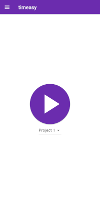
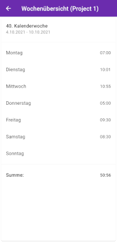
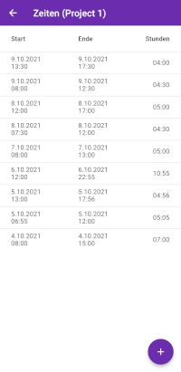

# timeasy

A time tracker application that ist build for simplicity.

Visit the timeasy website: <https://timeasy.org>

<p>
    <a href="https://apps.apple.com/us/app/timeasy-time-tracking/id1620757668?itsct=apps_box_badge&amp;itscg=30200">
      
    </a>
</p>
<p>
    <a href="https://play.google.com/store/apps/details?id=com.hilwerssoftware.timeasy">
        
    </a>
</p>





## Getting Started

### Keystore

In order to compile for Android the app needs to be signed with an appropriate key. To create a keystore and reference it please refer to the flutter documentation: https://docs.flutter.dev/deployment/android

After generating the keystore create a file named "key.properties" in the "android"-folder:

    storePassword=<password for your keystore>
    keyPassword=<password for your key>
    keyAlias=upload
    storeFile=<location of the key store file, such as /home/<user name>/keystore.jks>

### Translations

Before you begin you must generate the translation files. Otherwise the project will not be compilable:

    flutter gen-l10n

### Application icon

For setting the application icon the package "flutter_launcher_icons"
(https://pub.dev/packages/flutter_launcher_icons) is used. The configuration can be found in the
pubspec.yaml.

Just place your icon in the path configured in the pubspec.yaml and run

flutter pub run flutter_launcher_icons:main

## Using OpenTelemetry for Logging

### For Development (flutter run)

flutter run --dart-define=LOKI_ENDPOINT=<your-loki-endpoint> --dart-define=LOKI_BEARER_TOKEN=<your-bearer-token>

### For Production Builds

#### Android APK:

flutter build apk --dart-define=LOKI_ENDPOINT=<your-loki-endpoint> --dart-define=LOKI_BEARER_TOKEN=<your-bearer-token>

#### iOS:

flutter build ios --dart-define=LOKI_ENDPOINT=<your-loki-endpoint> --dart-define=LOKI_BEARER_TOKEN=<your-bearer-token>

### Additional Environment Variables

You can also optionally set these additional variables:
- ENVIRONMENT (defaults to 'development')

Example with all variables:
flutter build apk \
--dart-define=LOKI_ENDPOINT=https://your-loki-instance.com/loki/api/v1/push \
--dart-define=LOKI_BEARER_TOKEN=your_bearer_token_here \
--dart-define=ENVIRONMENT=production \

The telemetry logger will only initialize Loki logging if LOKI_ENDPOINT is provided and non-empty. If not provided, it falls
back to local console logging only.

## In-app purchases (RevenueCat)

Subscriptions inside the app are sold exclusively through the App Store and
Google Play (StoreKit / Play Billing via RevenueCat). The web client sells the
same subscription through Paddle on timeasy.org — all channels unlock the same
`timeasy_pro` entitlement, and the app never links to the web checkout.

### Prerequisites

Billing must be enabled on **both** sides:

- **Server:** set `revenuecat-api-key`, `revenuecat-project-id` and
  `revenuecat-entitlement-id` (see `server/README.md`). Without them
  `GET /api/v1/billing/status` reports `enabled: false` and the app never
  configures RevenueCat — even when the API key below is passed at build time.
- **App:** pass the public RevenueCat API key of the matching platform app at
  build time via `--dart-define`. The keys are public (they identify the app,
  not the user) and come from the RevenueCat project. Without them the app
  still builds and runs, but the paywall reports that subscriptions are
  unavailable.

### Building with in-app purchases

Development (`flutter run`):

```
flutter run --dart-define=REVENUECAT_IOS_API_KEY=appl_xxx
flutter run --dart-define=REVENUECAT_ANDROID_API_KEY=goog_xxx
```

Release:

```
flutter build ipa --dart-define=REVENUECAT_IOS_API_KEY=appl_xxx
flutter build appbundle --dart-define=REVENUECAT_ANDROID_API_KEY=goog_xxx
```

The defines combine with the other build variables. Both keys can be passed in
one command — the app uses the key matching the running platform:

```
flutter build appbundle \
  --dart-define=ENVIRONMENT=production \
  --dart-define=LOKI_ENDPOINT=https://your-loki-instance.com/loki/api/v1/push \
  --dart-define=LOKI_BEARER_TOKEN=your_bearer_token_here \
  --dart-define=REVENUECAT_ANDROID_API_KEY=goog_xxx
```

The keys are compiled into the binary; there is no runtime configuration.

### Store requirements for testing

- **Android:** Play Billing only works for builds distributed through Google
  Play. Upload the AAB to an internal testing track, register as a license
  tester and install the app from the Play Store. Sideloaded debug builds never
  load subscription offers.
- **iOS:** purchases run through StoreKit. Use a sandbox tester account on a
  real device (App Store Connect → Users and Access → Sandbox → Testers); in
  the simulator, test with a StoreKit configuration file in Xcode.
- `purchases_flutter` requires iOS 13.0 (configured in `ios/Podfile`).

The app uses the Keycloak user ID (JWT `sub`) as RevenueCat App User ID, so a
subscription purchased on any platform — including Paddle on the web — applies
to the same account. The server validates the `timeasy_pro` entitlement.

